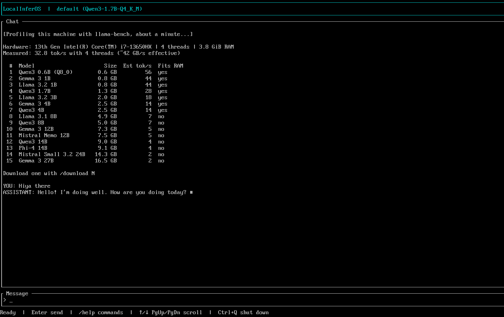

# LocalInferOS

A minimal BusyBox-based OS that boots straight into a terminal chat app for local LLMs (llama.cpp, CPU only). It profiles your hardware, estimates tok/s for each model, and downloads models from Hugging Face. Boots from a 16 GB USB stick (UEFI, Secure Boot off).

Needs an x86-64 CPU with AVX2 (~2013 or newer). Downloads need wired Ethernet or Android USB tethering (no Wi-Fi yet).

| Booting | Profiling and chat |
|---|---|
|  |  |

```
src/               Rust TUI (chat, profiling, downloads; starts llama-server)
vendor/llama.cpp/  Git submodule
iso/               build.sh (USB image), init (boot script), run-qemu.sh
```

## Build

On Ubuntu 24.04 (WSL works): the image uses the build machine's Ubuntu kernel and libraries. Also needs [Rust](https://rustup.rs).

```sh
git clone --recursive https://github.com/adixg/localinferos && cd localinferos
sudo apt install -y build-essential cmake ninja-build pkg-config libssl-dev busybox-static cpio \
  zstd grub-efi-amd64-bin mtools qemu-system-x86 ovmf

# llama.cpp, CPU only, portable to any AVX2 CPU
cmake -S vendor/llama.cpp -B build/llama-cpu -G Ninja -DCMAKE_BUILD_TYPE=Release -DGGML_NATIVE=OFF \
  -DGGML_CUDA=OFF -DLLAMA_BUILD_TESTS=OFF -DLLAMA_BUILD_EXAMPLES=OFF -DLLAMA_BUILD_SERVER=ON
cmake --build build/llama-cpu --target llama-server llama-bench -j 8

# Bundled default model
mkdir -p models && curl -L -o models/Qwen3-1.7B-Q4_K_M.gguf \
  https://huggingface.co/ggml-org/Qwen3-1.7B-GGUF/resolve/main/Qwen3-1.7B-Q4_K_M.gguf

iso/build.sh     # -> dist/LocalInferOS-v0.1.img, 14 GiB (asks for sudo once)
iso/run-qemu.sh  # boot it in QEMU as a USB stick; RAM=8G CPUS=8 to override
```

Flash the image with balenaEtcher, Rufus (DD mode) or `dd`. If Windows then asks to format the drive, click Cancel. QEMU needs KVM access: `sudo usermod -aG kvm $USER`, then restart WSL (`wsl --shutdown`).

## Commands

| Command | |
|---|---|
| `/profile` | Benchmark this machine, estimate tok/s per model (runs on first boot) |
| `/download N` | Download model N from the profile table (`N force` if it may not fit in RAM) |
| `/cancel` | Stop the download (`/download` again resumes) |
| `/delete N`, `/storage` | Delete a downloaded model, show disk usage |
| `/models`, `/use N` | List models, switch model (clears chat) |
| `/clear`, `/help` | Start a new chat, list commands |

Chats are saved to the stick (`/data/history`) and the last one is restored on boot. The profile is per machine: moving the stick to another computer profiles it again.

↑/↓, PgUp/PgDn and End scroll; Ctrl+Q shuts down (just quits outside the OS), Ctrl+C exits the TUI (Enter restarts it). `localinferos --profile` prints the profile without the TUI.
